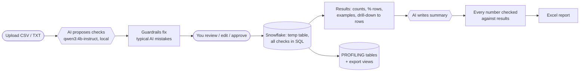

# AI Data Profiling Agent

A web tool for healthcare data-migration profiling: upload a source extract, a **local AI model proposes
the checks** for every column, **Snowflake runs them on every row**, and you get exact counts, the failing
rows, and a **client-ready report** (Excel) with an AI-written summary whose numbers are verified.
It also hosts the **Pipeline page** of [hc-ai-agent-pipeline](https://github.com/Lavanya-developer0309/hc-ai-agent-pipeline):
approve or reject the pipeline agent's actions and read every decision it made.

**Design rule: AI decides *what* to check, SQL does the *counting*.** Every number shown comes from Snowflake.



## What it does
| Step | |
|---|---|
| **1. Upload** | CSV / TXT / TSV, delimiter detected, preview |
| **2. AI proposes checks** | per column: type (ID, name, date, DOB, phone, SSN, tax id, ZIP, state, code, amount…), required, unique, min/max length, date format, allowed values — you edit and approve |
| **Guardrails** | small models make predictable mistakes — e.g. copying the *bad* sample values (`1`, `2`, `X`) into a gender allowed list. Code removes copied allowed lists, forces gender to M/F/U, drops length rules most samples break, keeps one unique key — and says what it changed |
| **3. Snowflake checks** | file loaded into a temporary table; one SQL query per family of checks on every row; SSN / tax id masked |
| **Drill-down** | click any count → the exact rows (row #, key, value, length, full record), CSV export |
| **Saved results** | `HC_MIGRATION_DB.PROFILING`: `PROFILE_RUN`, `PROFILE_COLUMN`, `PROFILE_CHECK_RESULT`, `PROFILE_FAILED_ROW` + views; re-profiling a file replaces only that file's rows |
| **4. Client report** | AI writes headline, findings, recommendations; any number not found in the results is rejected (one retry, then a standard summary). Severity is set by rules, not by the AI. Excel with Summary / All checks / Column profile / Rules used |
| **Pipeline page** | approvals waiting for you (human mode) with Approve / Reject + note; agent run history with each decision and reason |

Verified against issues planted in the synthetic test file: 16 bad gender codes, 10 duplicate members,
5 missing + 3 invalid dates of birth, 8 first names with special characters, 3 last names with extra spaces — all exact.

## Run
```bash
cp .env.example .env     # fill in your Snowflake account and key-pair path
./run.sh                 # creates .venv on first run, starts Ollama if needed -> http://127.0.0.1:5050
```
Create an account on the login page (stored locally, passwords hashed, lockout after 5 failed attempts).
AI: [Ollama](https://ollama.com) with `qwen3:4b-instruct` (`ollama pull qwen3:4b-instruct`). Set `AI_PROVIDER=cortex`
to use Snowflake Cortex instead (paid accounts only) or `none` for the built-in rules.

## Tests
```bash
.venv/bin/python tests/test_app.py     # 22 tests: login, CSRF, uploads, guardrails, real Snowflake run, report, pipeline approvals
```
The Snowflake test uploads as `ZZ_TEST_SRC_MEMBER.txt` and deletes its own rows, so real results are never touched.

## Layout
```
app.py              Flask routes: login, profiling API, report, pipeline page
auth.py             users (SQLite), hashed passwords, lockout
ai.py               AI provider: Ollama (default) / Snowflake Cortex / none
sf.py               Snowflake key-pair connection
profiling/rules.py  AI prompt, built-in rules, guardrails
profiling/checks.py approved rules -> Snowflake SQL (exact counts, examples, failing row numbers)
profiling/store.py  permanent PROFILING tables (per-file replace in one transaction)
profiling/report.py AI summary + number verification + Excel
sql/                PROFILING tables / views and ready-made export queries
templates/ static/  the web pages
samples/            synthetic test extracts (same as the migration project's BATCH_001)
```

## Related projects
- [snowflake-healthcare-data-migration](https://github.com/Lavanya-developer0309/snowflake-healthcare-data-migration) — the dbt + Snowflake migration (legacy → Facets-like target)
- [hc-ai-agent-pipeline](https://github.com/Lavanya-developer0309/hc-ai-agent-pipeline) — S3 + Snowpipe + Airflow + dbt run by a local AI agent

## Cost
Free: Ollama runs locally; Snowflake usage is a few seconds of an XS warehouse per run (trial credits).
